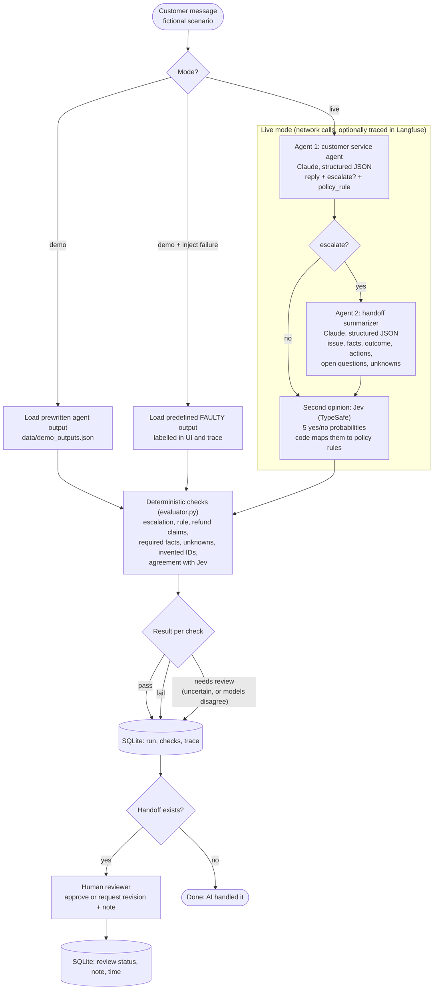

# Handoff Lab architecture

This document is for engineers who want to understand exactly what happens in a run, why each piece exists, and where to change things. The README covers setup.

## The agent workflow

Every arrow in the live branch is a function call in `backend/main.py:_execute`. There is no framework and no hidden orchestration: the order above is the order of the code.

## Components

| File | Responsibility | Talks to |
|---|---|---|
| `backend/main.py` | FastAPI routes; `_execute` runs one scenario end to end and builds the trace | everything below |
| `backend/agents.py` | The two Claude calls, with structured output validated by Pydantic | Anthropic API |
| `backend/jev.py` | Five yes/no questions to Jev; `rules_from` turns probabilities into policy rules | TypeSafe API |
| `backend/evaluator.py` | All deterministic checks; pure functions, no I/O | nothing |
| `backend/tracing.py` | Optional Langfuse spans, generations and scores; no-ops when unconfigured | Langfuse |
| `backend/db.py` | SQLite persistence with parameterised queries | local file |
| `backend/models.py` | Pydantic schemas for model output and API input | nothing |
| `backend/compare.py` | CLI: runs every scenario live and prints agent vs Jev vs expected | all of the above |
| `frontend/src/Lab.tsx` | Scenario selector, run panel, results, review, history | `/api/*` |
| `frontend/src/Scene3D.tsx` | Three.js scene; lazy-loaded so the app works without WebGL | nothing |
| `frontend/src/Pages.tsx` | The Why, How and In practice pages | nothing |

## Why two models? (Claude and Jev)

They do different jobs, and the disagreement between them is the useful signal.

- **Claude writes.** It has to produce a reply a customer will read and a handoff a person will act on. That needs a general model with reasoning.
- **Jev judges.** It answers narrow yes/no questions ("does the customer explicitly ask for a human?") and returns a probability, not text. Jev is fast and cheap, about 400 input and 90 output tokens per run, and its answers are easy for code to consume.
- **Code applies the rules.** Jev never decides "escalate". It reports facts about the message, and `jev.rules_from` applies the written policy. The $100 refund threshold is arithmetic in code, not a model judgment.
- **Disagreement goes to a person.** If the rules Jev's signals trigger don't match Claude's decision, the check is marked *needs review*, not fail. Two independent models agreeing is strong evidence. Disagreeing is exactly when a human should look.

On the six scenarios, Jev's signals are near 0.99 where a rule applies and near 0.02 where it doesn't. The upset customer scores 0.98 on "upset" but 0.02 on every rule trigger, which is the policy's "being upset is not a reason to escalate" rule expressed in data.

## Why Langfuse?

The in-app trace shows one run. Langfuse shows all of them over time, which is what you need to operate an agent:

- **Every model call, inspectable:** the exact system prompt, input, output, token counts, stop reason and latency for each Claude and Jev call.
- **One trace per run:** the root span `Handoff Lab run` contains `Customer service agent`, `Handoff summarizer`, `Jev signals` and `Deterministic checks` in order.
- **Scores you can chart:** each live run records `checks_failed`, `checks_needs_review` and `escalation_correct`. After a prompt or model change, the dashboard shows whether quality moved.
- **Optional by design:** `tracing.py` turns every call into a no-op unless `LANGFUSE_PUBLIC_KEY` and `LANGFUSE_SECRET_KEY` are set. Demo runs are never traced. `tests/test_tracing.py` checks the span structure with an in-memory exporter, so no account is needed to test it.

## Checks: what "pass", "fail" and "needs review" mean

A check passes only on positive evidence. It fails only when the evidence is unambiguous: a wrong escalation decision, an affirmative refund promise, a missing handoff, or an invented account ID. Everything uncertain becomes *needs review*: a paraphrased fact, a negated claim, a model disagreement, or an unexplained dollar amount. This keeps the false-pass rate low at the cost of more human review, which is the right trade for customer-facing AI.

## Data flow and privacy

| Mode | Leaves the machine | Stored locally |
|---|---|---|
| Demo | Nothing | Run, checks, trace, review in SQLite |
| Live | Policy + scenario to Anthropic; customer message to TypeSafe; if configured, prompts, outputs and scores to Langfuse | Same, plus model outputs |

All scenario data is fictional. Reviewer notes are stored until the SQLite file is deleted. There is no delete endpoint, which is acceptable for fictional data and should be added before any real data is used.

## Security model

- **Keys stay server-side.** The browser talks only to the FastAPI backend through the Vite proxy. `/api/health` returns booleans and the model name, never a key. Error messages and debug output carry the step, stop reason, request ID and truncated model output only.
- **Local only by default.** Uvicorn binds to `127.0.0.1`. There is no login, so **never start it with `--host 0.0.0.0`** on shared Wi-Fi: anyone could start paid live runs and read reviewer notes.
- **CSRF guard.** Every POST must carry an `X-Handoff-Lab: 1` header. A page on another site cannot add a custom header without a CORS preflight, which this API never approves, so other tabs can't trigger live runs.
- **Input limits.** The reviewer note is limited to 2000 characters during validation. Scenario IDs are dictionary lookups, never file paths.
- **No injection paths.** SQL uses `?` placeholders, and column names come only from server-built dictionaries. React renders all text escaped; there is no `dangerouslySetInnerHTML`. Users cannot send free text to any model, which limits prompt injection.
- **Pinned dependencies.** `requirements.txt` and `package-lock.json` pin exact versions so the demo behaves the same on every machine.

## Extending it

- **Add a scenario:** append to `data/scenarios.json` (message, context, expected escalation, required facts, unknowns) and add a demo sample to `data/demo_outputs.json`. The parametrised tests pick it up automatically.
- **Add a check:** write a pure function in `evaluator.py` returning `CheckResult`s, add it to `evaluate`, and add a test.
- **Add a Jev signal:** add a `Noul` to `jev.QUESTIONS` and a label, then map it in `rules_from`.
- **Connect a real agent:** replace `run_live` with a call to your agent's API that returns the same `AgentResult` and `Handoff` shapes. Everything downstream stays the same.
